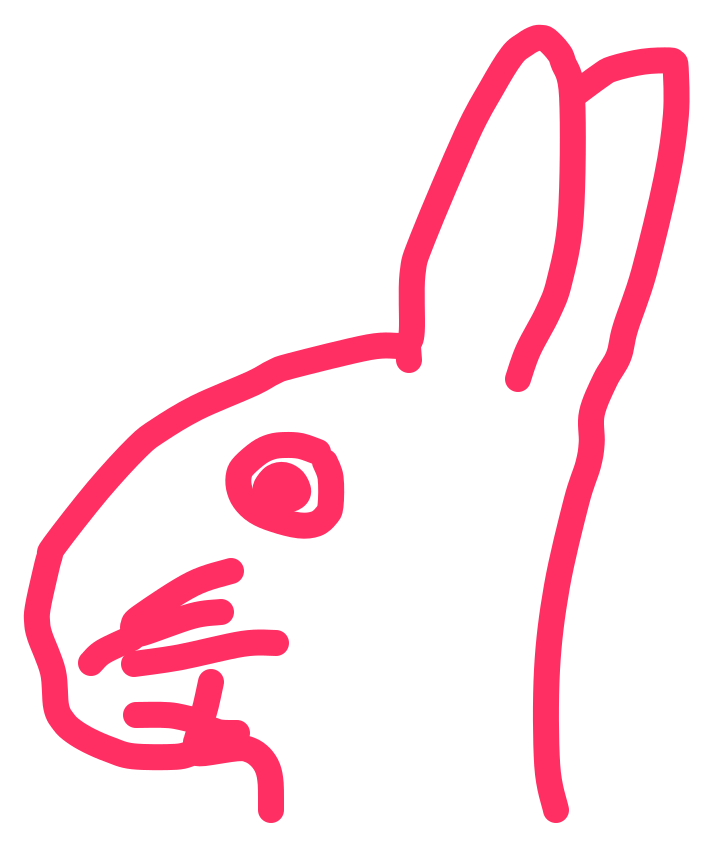

<div align="center">



# Tapiti

Floors for games and experiments, dug from a seed: rooms, doors and corridors
that always connect.

[](https://github.com/Lucas-BRT/tapiti/actions/workflows/ci.yml)
[](https://github.com/Lucas-BRT/tapiti/releases/latest)
[](LICENSE)
[](rust-toolchain.toml)
[](docs/getting-started.md#install)

</div>

Tapiti digs a floor from a seed: rooms of many shapes joined by doors and
corridors, with a validator that checks the result and measures that tell how
the floor plays. Pick a seed, a size and a layout, change any parameter, and
the floor is dug again in a moment. It runs as a desktop app and in the
browser.

## Features

- **Same seed, same floor.** A seed and its parameters draw the same floor on
  every machine and in the browser, so a floor can be shared as a number.
- **Rooms of many shapes.** Rectangles, discs, octagons, L shapes and stars,
  with doors, corridors at right angles and diagonals, junctions and side
  chambers.
- **Two layouts.** One room per grid block, or rooms that grow one from
  another, for a floor that does not look like a grid.
- **Always valid.** Every floor is checked: rooms keep their distance,
  corridors stay clear of the rooms they do not join, every room can be
  reached and, when asked for, there is an entrance and a distant exit.
- **Understand the floor.** Loops, dead ends, bridges, alternative routes to
  the exit and how connected the floor is, in charts with plain explanations.
- **Every parameter is yours.** Edit them in the app or in the browser, copy
  them as JSON, and copy the floor as an SVG image.

## Install

```bash
curl -fsSL https://raw.githubusercontent.com/Lucas-BRT/tapiti/main/install.sh | bash
```

For Linux on x86_64, without `sudo`. Each [release](https://github.com/Lucas-BRT/tapiti/releases/latest)
also has a `.deb`, an `.rpm`, a Windows `.exe` and a macOS app: see
[getting started](docs/getting-started.md#install).

## Usage

Open the app, choose a layout and a size at the top, type a seed and press
Generate. The side panel has the parameters and the analysis of the floor; the
File menu opens and saves a set of parameters and copies the floor as SVG.
More in [getting started](docs/getting-started.md).

## Documentation

Every page is in [docs/](docs/): [getting started](docs/getting-started.md),
the [model](docs/model.md) behind the floors, the [desktop app](docs/desktop-generation-rendering.md),
[performance](docs/performance-memory-review.md), [development](docs/development.md)
and the [roadmap](docs/roadmap.md).
